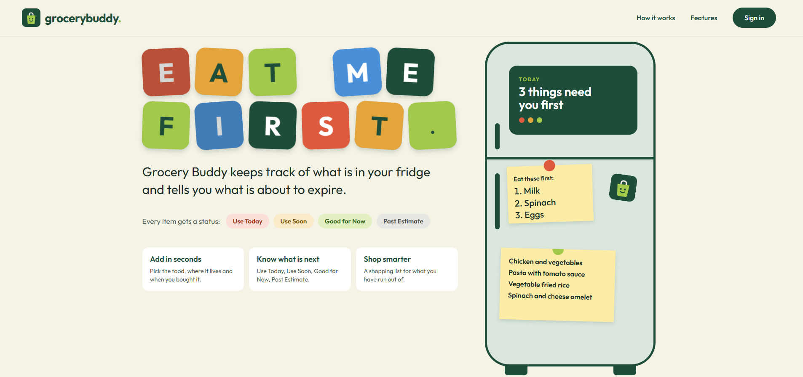

# Grocery Buddy

## Project Description

Grocery Buddy is a web app that helps college students keep track of their groceries and eat food before it goes bad. Students add groceries in a few quick steps: the food, how much they have, where it is stored (fridge, freezer, or pantry), and the date they bought it. The app estimates how long each item will last and shows a dashboard with labels like "Use Today," "Use Soon," "Good for Now," and "Past Estimate." Students can mark food as used or thrown away, keep a shopping list, and get AI recipe ideas for food that needs to be used soon.



**Project status:** The app has three pages so far:

- **Landing page:** shows the "EAT ME FIRST." letter tiles, a short description, the four item statuses, three feature cards, and a fridge drawing with sticky notes. Clicking **Sign in** opens onboarding.
- **Onboarding:** a short quiz about how the student shops and cooks.
- **Dashboard:** sorts items into the four status columns. It uses sample data for now.

Moving between pages plays a slide animation. Item tracking, the shopping list and AI recipe ideas are still being built, along with the Django backend described below.

## Installation Instructions

You need these programs before you start:

- [Git](https://git-scm.com/downloads), to download the code
- [Node.js](https://nodejs.org/) version 20.19 or newer, which also installs npm (the tool that downloads the project's packages)
- A code editor such as [VS Code](https://code.visualstudio.com/) (optional)

To check that Node.js is installed, open a terminal and run:

```bash
node --version
```

Then download the project and install its packages:

```bash
git clone https://github.com/cis3296-f26/GroceryBuddy.git
cd GroceryBuddy
npm install
```

You only need to run `npm install` the first time, and again if someone adds a new package.

## Build Instructions

Inside the `GroceryBuddy` folder, run:

```bash
npm run build
```

This makes a `dist` folder with the finished files that a web server can host.

## Run Instructions

To start the app while you work on it, run:

```bash
npm run dev
```

The terminal shows a link, usually http://localhost:5173. Open it in your web browser to see the app. The page updates by itself when you save a file. To stop the app, click in the terminal and press `Ctrl + C`.

To try the version you built in the Build step, run:

```bash
npm run preview
```

Then open the link it shows, usually http://localhost:4173.

These steps were tested on Windows 11 with Node.js 24 and npm 11.

## Django Backend Setup

The project now includes a Django backend in `backend/`, alongside the React frontend in `src/`. Django apps are scaffolded for accounts, inventory, recipes, and shopping. Settings read the Supabase PostgreSQL connection from `DATABASE_URL`, and the Vite development server forwards `/api` requests to Django. Feature endpoints remain under development.

### Backend Installation

Install Python 3.12 or newer. The backend has been checked locally with Python 3.13.

From the repository root:

```bash
cd backend
python3 -m venv .venv
source .venv/bin/activate
python -m pip install -r requirements.txt
cp .env.example .env
```

On Windows PowerShell, use `py -m venv .venv`, `.\.venv\Scripts\Activate.ps1`, and `Copy-Item .env.example .env` in place of the corresponding commands above.

Generate a Django secret key:

```bash
python -c "from django.core.management.utils import get_random_secret_key; print(get_random_secret_key())"
```

Edit `backend/.env` and set:

- `DATABASE_URL`: the PostgreSQL connection URL supplied by the database maintainer. Use the direct or session-pooler connection agreed with the team. Django requires SSL for this connection.
- `SECRET_KEY`: the generated key, enclosed in double quotes.
- `DEBUG`: `True` for local development.
- `ALLOWED_HOSTS`: `localhost,127.0.0.1` for local development.

The settings load `.env` from the backend directory. Existing process environment variables take precedence. Never put database credentials in frontend code or `VITE_` variables.

Git ignores `.env` files and `.venv/`. Commit `.env.example` with placeholders only. Each developer should create their own virtual environment and obtains credentials privately.

## Run Locally

Run the backend and frontend in separate terminals.

### Terminal 1: Backend

From the repository root:

```bash
cd backend
source .venv/bin/activate
python manage.py runserver
```

On Windows, activate with `.\.venv\Scripts\Activate.ps1` instead.

Open http://127.0.0.1:8000/api/health/. Expected response:

```json
{"status": "ok"}
```

The health endpoint confirms Django is serving requests; use the database verification command above to check database connectivity separately.

### Terminal 2: Frontend

From the repository root:

```bash
npm run dev
```

Open the address shown in the terminal, usually http://localhost:5173. Vite forwards `/api` requests to Django at `http://127.0.0.1:8000`, so http://localhost:5173/api/health/ should return the same JSON. Both servers must be running. Frontend code can call relative URLs such as `fetch('/api/health/')`.

Press `Ctrl+C` in each terminal to stop its server. React updates as frontend files change; Django reloads when backend Python files change.

## Backend Deployment

The backend is hosted on Render Free at https://grocerybuddy-q2vi.onrender.com. Deploy from `main` with root directory `backend`:

- **Build:** `pip install -r requirements.txt`
- **Start:** `python manage.py migrate --noinput && gunicorn grocery_buddy.wsgi:application --bind 0.0.0.0:$PORT`
- **Health check:** `/api/health/` (returns `{"status": "ok"}`; does not test database connectivity).

Set these environment variables in Render:

| Variable | Value |
| --- | --- |
| `DATABASE_URL` | Supabase PostgreSQL session-pooler connection string |
| `SECRET_KEY` | Generated secret; keep private |
| `DEBUG` | `False` |
| `ALLOWED_HOSTS` | `grocerybuddy-q2vi.onrender.com` |
| `GOOGLE_CLIENT_ID` | Google OAuth web client ID |
| `CSRF_TRUSTED_ORIGINS` | `https://grocerypal-three.vercel.app,https://grocerybuddy-q2vi.onrender.com` |
| `SUPABASE_URL` | Same Supabase project URL as the frontend |
| `SUPABASE_PUBLISHABLE_KEY` | Supabase publishable or anon key for token verification |
| `GEMINI_API_KEY` | Private Gemini key (`GOOGLE_API_KEY` is also supported) |
| `GEMINI_MODEL` | Model ID agreed with the AI owner; defaults to `gemini-3.5-flash-lite` |

UptimeRobot checks the health endpoint every 5 minutes to help prevent idle sleep. Free services can still restart. Keep credentials out of this README and Git.

## AI Generation

AI helpers live under `backend/recipes/services/`, `backend/shopping/services/`,
and `backend/inventory/services/`, so Render includes them when deploying from
`backend/`. Recipe and shopping generation share the Gemini client boundary in
`grocery_buddy/ai.py`. Live local verification with the configured Gemini model has succeeded using
synthetic groceries. AI answer quality still needs review: responses can assume
precooked ingredients or give inconsistent preparation times despite prompt rules.

The generation endpoints accept `POST` with an empty JSON object (`{}`), using
the same Supabase bearer token as inventory requests. They read only the signed-in
user's active groceries (quantity greater than zero); client-supplied ingredients,
history, and owner IDs are rejected. They don't save generated suggestions.

- `/api/recipes/generate/` returns `{"recipes": [...]}` with `name`, `time_minutes`,
  `uses`, `ingredients`, and `steps` for each recipe. Items past their explicit or
  estimated use-by date are excluded; remaining items are prioritized by urgency.
- `/api/shopping/generate/` returns `{"items": [...], "history_available": false,
  "detail": "..."}`. Each suggestion has `name`, `category`, `quantity`, and `reason`.
  Suggestions currently use inventory only. Used/Tossed history is not recorded yet.

Both routes cap inventory input at 100 active items, share a per-user throttle of
5 requests per minute, and use a 20-second provider timeout without automatic
retries. The default Django cache makes throttling local to each process; a shared
cache is needed for a service-wide limit across multiple workers/instances.
Errors use JSON `detail`: 400 for invalid input or no usable groceries, 401 for
missing bearer authentication, 429 for throttling, 502 for invalid AI output, and
503 for missing credentials/SDK or provider failures. Session authentication also
works with CSRF protection. Responses are marked private/no-store.

These routes are implemented locally; Render won't have them until deployment.
The frontend is connected to recipe generation, shopping suggestions, and recipe chat
through the authenticated API client. Live local checks verified successful recipe,
shopping, and chat responses, chat history, empty-inventory chat, and authentication
using an isolated test database and synthetic users.
Configure `GEMINI_API_KEY` on the backend and deploy both applications to enable
these changes in production. Never expose the Gemini key in frontend variables.

Run matcher tests without a database or Gemini requests:

```bash
backend/.venv/bin/python -m unittest discover -s test
```

For backend tests, set `TEST_DATABASE_URL` to a dedicated local PostgreSQL server,
then run (from `backend/`):

```bash
python manage.py test --settings=grocery_buddy.test_settings
```

Tests mock Gemini and must never target the shared application's database.

## API Routing

| Path | Status |
| --- | --- |
| `/api/health/` | Returns `{"status": "ok"}` |
| `/api/accounts/` | Reserved for account endpoints |
| `/api/inventory/items/` | Authenticated inventory CRUD |
| `/api/recipes/generate/` | Authenticated recipe generation (POST) |
| `/api/shopping/generate/` | Authenticated shopping suggestions (POST) |

The bare recipe and shopping prefixes still return 404; use their `generate/` routes.

### Recipe assistant chat

`POST /api/recipes/chat/` accepts `{"message": "What can I cook?", "history": []}`
and returns `{"reply": "..."}`. Messages are limited to 500 characters and history
to 10 user/assistant messages of at most 6000 characters each. The server reads
only the authenticated user's active inventory, excludes items past their use-by
date, and shares the generation throttle and error handling above. General
questions work with empty inventory. Chat history stays in the current page;
it is sent as conversational context and is not saved by the backend.
